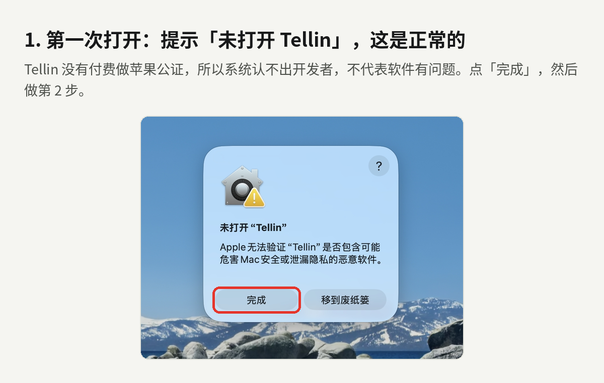
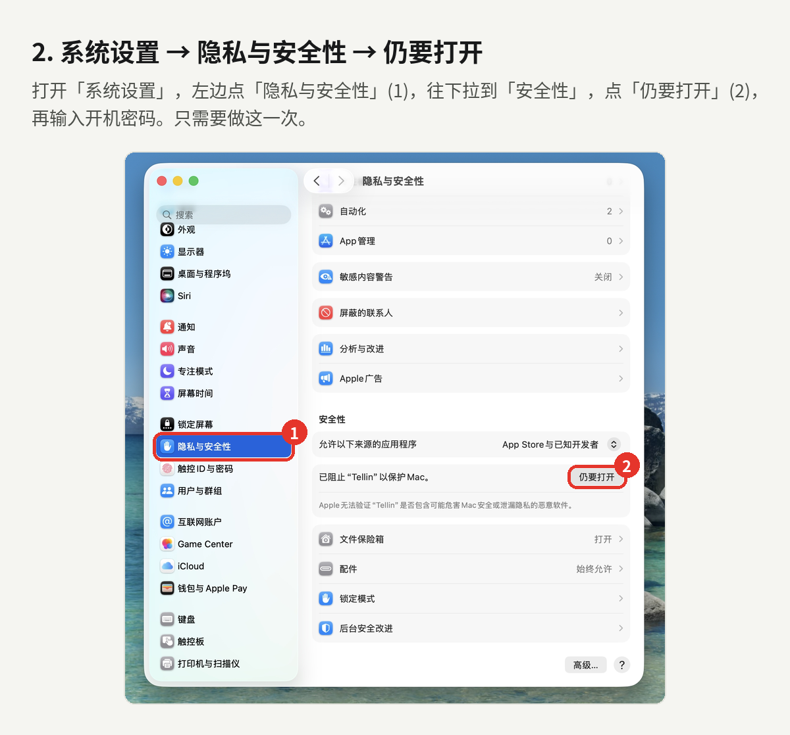
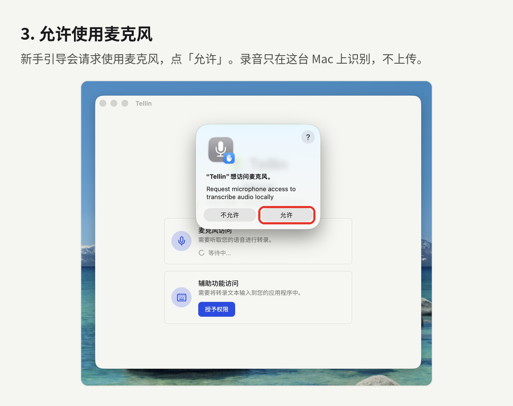
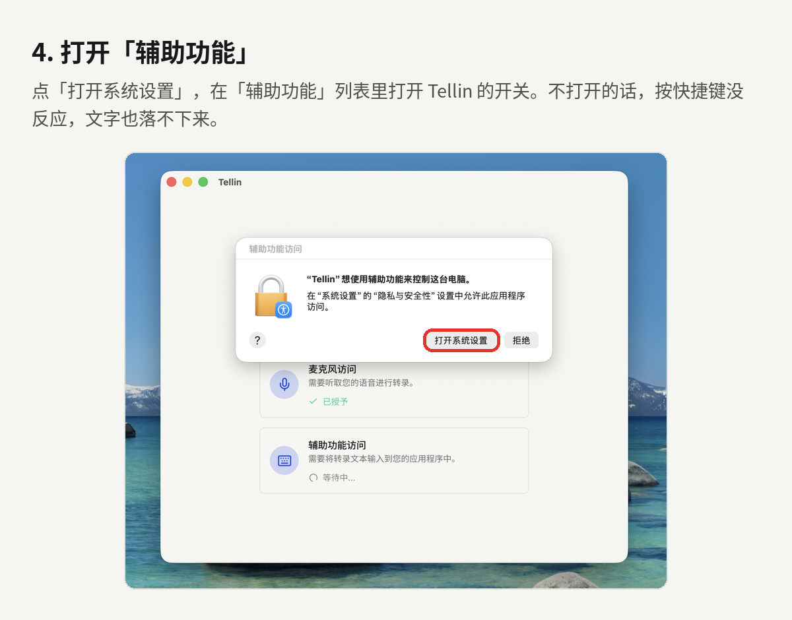
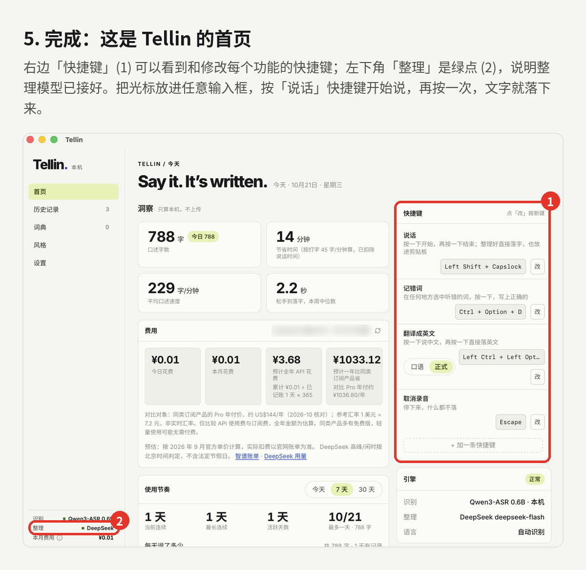

[中文](README.md) | English

# Tellin

**Tellin: voice input for Mac. Speak, and cleaned-up text lands at your cursor.**

[**Download Tellin · Apple silicon Mac**](https://github.com/LK66LK/tellin/releases/latest)

Free to use. Speech recognition runs on your Mac. Connect your own model service for cleanup or translation.

## 1. What it does

The cleanup examples below assume a connected cleanup model. They illustrate the intended behavior; actual output may differ.

- **Speak** removes filler, keeps your final correction, separates different topics into numbered sections, and uses digits for dates, times and reference numbers. For example, “Um, meet Tuesday, no, Wednesday, reference two-six-one-zero-two-zero” can become “Meet Wednesday, reference 261020.”
- **Local dictation** recognizes speech without calling a cleanup model and works offline. For example, dictate “The meeting is at 3 PM tomorrow. Bring the contract” into Notes.
- **Translate to English** turns spoken Chinese into English, with **Casual** and **Formal** styles. For example, “明天下午三点开会” can become “The meeting is at 3 PM tomorrow.”
- **Fix misheard word** lets you select an incorrect word, press a shortcut and enter its correct spelling for future corrections. For example, save the intended project name “海岚项目” when it is heard as “海兰项目”. Still check important names and numbers.

## 2. System requirements

- An Apple silicon Mac: M1 or later. Intel Macs are not supported.
- macOS 11 or later. The author's test machines run macOS Tahoe 26.6.2 and macOS Tahoe 26.3.1(a). Other versions have not been individually tested.
- Allow roughly 2 GB for the installer and model, plus extra space for extracting and copying during installation. Recorded history takes additional space.

## 3. Download and install

### 3.1 Download

1. Open the download link above.
2. Find **Assets** on the release page and click `Tellin_1.0.0_aarch64.dmg`. Do not download **Source code**; it is not the installer.
3. The measured installer size is **824,357,057 bytes: approximately 824 MB (786 MiB)**. Download time has not been measured and depends on your connection to GitHub.

### 3.2 Open the DMG

1. Double-click the downloaded DMG. macOS may display a verification progress bar. Allow roughly 1 minute rather than cancelling as soon as the bar appears. This is a waiting-time guide, not a measured duration.
2. The installer window shows Tellin on the left, a blue arrow in the middle and **Applications** on the right. **Drag Tellin into Applications** and wait for copying to finish.
3. A pale-green strip explains the first-open procedure. Eject the Tellin disk when installation is complete.

The downloaded DMG may have a plain system icon. This does not affect installation; Tellin's disk and installer appearance are visible after opening it.

### 3.3 macOS blocks the first launch

Tellin 1.0.0 has not been notarized by Apple. Its author has not joined the paid Apple Developer Program, whose standard annual fee is US$99. macOS therefore cannot verify the developer. This warning alone does not establish that malware was found, nor does it certify safety. Download only from this repository. See [Apple's guidance on opening apps](https://support.apple.com/en-us/102445) and the [Developer Program](https://developer.apple.com/programs/).

On macOS 15 or later:

1. Double-click Tellin in Applications. When the blocking alert appears, click **Done**.



2. Open **System Settings → Privacy & Security**, scroll to the Tellin notice and click **Open Anyway**. Authenticate with your Mac password if asked, then confirm opening.



On older macOS versions, try right-clicking Tellin and choosing **Open**. If unavailable, use **Open Anyway** in the system security settings. You normally only need to do this once for the same version.

For a “damaged and can't be opened” message, see section 9.1.

### 3.4 First launch

1. The **Permissions Required** page has **Microphone Access** and **Accessibility Access** cards. Click **Grant Permission** for each and complete the steps in section 4. It shows **All set!** when both are granted.
2. Qwen3-ASR 0.6B is bundled with the app. Tellin copies and selects it on first launch, without another download, and normally proceeds to Home. Allow a few seconds initially; this is a rough guide, not a measured launch time.
3. Home displays **One more step: connect a cleanup model**, with **DeepSeek · recommended** selected. Follow section 6 or start with local dictation.

## 4. Permissions

### Microphone

This lets Tellin hear your speech. Use the microphone card on the permissions page and click **Allow** in the system prompt. If you previously denied access, enable Tellin under **System Settings → Privacy & Security → Microphone**.



### Accessibility

This lets Tellin respond to global shortcuts, insert text into another app and support the correction actions you choose. Grant access from the accessibility card, then click **Open System Settings** in the system prompt.



Enable Tellin under **System Settings → Privacy & Security → Accessibility**, then return to Tellin. Without access, shortcuts or automatic text insertion may not work. On older macOS versions, the equivalent path may be **System Preferences → Security & Privacy → Privacy**.

Audio is recognized on your Mac. Accessibility also supports selected text corrections; it is not permission to upload audio. The shared illustrations use the Chinese interface.

## 5. Start using Tellin

This is Home after setup. The figures and shortcuts shown belong to this test machine.



You can change shortcuts on the right of Home. Use the combinations shown in your own app.

| Action | Default shortcut | What it does |
|---|---|---|
| Speak | ⌥ ⇧ Space | Tap to start, tap again to stop; cleaned-up text is inserted at the cursor |
| Local dictation | ⌥ Space | Recognizes without calling a cleanup model; works offline |
| Translate to English | Left ⌃ + Left ⌥ + T | Speak Chinese; English is inserted when you stop |
| Fix misheard word | ⌃ ⌥ D | Select an incorrect word, then press the shortcut and enter its correct spelling |
| Cancel recording | Esc | Cancels without inserting text |

⌥ means Option, ⇧ means Shift and ⌃ means Control. Home lists Speak, Fix misheard word, Translate to English and Cancel recording. Change Local dictation under **Settings → General → Transcribe Shortcut**.

Try it:

1. Open WeChat or Notes and place the cursor in a text field.
2. Tap **⌥ ⇧ Space**.
3. Say “The meeting is at 3 PM tomorrow. Bring the contract.”
4. Tap again, wait for the text, and check it before sending.

**Settings → General → Shortcut Behavior** has 3 options:

| Option | When to choose it |
|---|---|
| Auto (default) | Supports both tap-to-toggle and hold-to-record; release to stop when holding |
| Hold | Record only while holding the shortcut, then release to stop |
| Toggle | Keep your hands free: tap to start and tap again to stop |

To keep each result ready for manual pasting, choose **Copy to Clipboard** under **Settings → Advanced → Output → Clipboard Handling**. **Don't Modify Clipboard** preserves the previous clipboard content.

## 6. Connect DeepSeek (optional)

Without a cleanup model, Speak still recognizes speech, applies basic local cleanup and uses your dictionary; Local dictation is unaffected. Translate to English requires an available cleanup model. If it is not connected, Tellin reports the failure and puts the Chinese text on the clipboard.

Tellin recommends DeepSeek. Home also offers **Zhipu · free** for trying the app. The app describes that option as weaker for paragraphing and corrections. Results, availability and provider prices can change.

1. On Home, select **DeepSeek · recommended** in **One more step: connect a cleanup model**, then **Sign up / sign in** to open the [DeepSeek platform](https://platform.deepseek.com/).
2. Follow the platform's registration instructions. Open its top-up page; ¥10 is a starting amount. Payment goes directly to DeepSeek. Tellin itself is free.
3. Open **API keys → Create API key** and copy the generated key, normally shown in full only once. Do not share it.
4. Paste it into Tellin's Home card and click **Save & test**. The pale-green **✓ DeepSeek is connected** card confirms that the test succeeded.
5. Check again under **Settings → Cleanup model → Test connection**. Replace a key under **Settings → Cleanup model → API keys → DeepSeek API key**.

The provider charges by usage. The author estimates approximately **¥1.25 per month** as an everyday-use reference, not a fixed subscription price or a measured guarantee. Actual cost depends on the model, text length and number of requests. The DeepSeek bill is authoritative.

Configure **Backup model** under **Settings → Cleanup model**. Select and configure another provider, or choose **No backup**. The app explains:

> Optional. If the main model hasn't answered within 1.5 s (longer for long texts) or fails, the same text is also sent to the backup — both may bill that request. Choose “No backup” to only ever use the main model.

Keys normally use the Mac login Keychain. Settings shows only the last 4 characters; **Remove** removes a saved key. This version can fall back to the local settings file if writing to Keychain fails, so do not share your app data folder.

## 7. Common settings

### 7.1 Change shortcuts

- **Where:** Home → Shortcuts → the relevant action → **Change**, then press the new combination. Local dictation is under **Settings → General → Transcribe Shortcut**; the cancel key is under **Cancel Shortcut** on that page.
- **Options:** custom combinations. Avoid common combinations such as ⌘N, ⌘C and ⌘V, and avoid assigning the same shortcut to multiple actions. Choose another combination if it conflicts.
- **Shortcut engine:** **Settings → General → Shortcut engine**. The default **Tellin Keys (recommended)** supports modifier-only shortcuts and handles hold-to-talk best. Try **System shortcuts** only if Tellin Keys is not working.

### 7.2 Microphone

- **Where:** Settings → General → Sound → Microphone.
- **Options:** the system default or a connected input device.
- **Recommendation:** start with your Mac's built-in microphone. Bluetooth headset microphones can reduce recording quality and recognition accuracy. Automatic selection avoids recognized remote-control virtual microphones; select a device manually if necessary.

### 7.3 Cleanup style

- **Where:** Style → My rules.
- **Always end with:** enter a fixed suffix such as `//`. Optionally enable **Only in AI & coding apps (Claude, ChatGPT, Codex, Cursor…)**. Use it to separate successive inputs, or leave it blank.
- **Extra instructions for cleanup:** enter up to 500 characters, such as “No exclamation marks”, then click **Save**. With instructions set, short phrases also go to the model, potentially adding time and cost. Leave blank if unnecessary.
- **Tone by app:** under Style → Tone by app, or Settings → Advanced → Transcription → Adjust tone per app. Enable it for conversational chat text and lists of separate AI requests; disable it to use the same general rules everywhere.

### 7.4 Translation style

- **Where:** Home → Shortcuts → Translate to English.
- **Options:** **Casual** for chat or **Formal** for email and work. Formal is the default.
- Requires a connected cleanup model. Changing the style does not send the text for you.

### 7.5 Dictionary

1. Open **Dictionary → + New word**.
2. Enter the spelling under **Correct form**, and mishearings under **Often heard as**, separated by commas. Use **Note (optional)** if helpful.
3. Click **Save**. Existing entries can be edited or deleted.

A new dictionary is empty and lists only entries you add or confirm. This is normal.

| Setting and location | How to choose |
|---|---|
| Dictionary → Recognise common AI names | On by default. About 30 common tool names guide contextual cleanup, such as “克劳德” → Claude. They do not appear as personal dictionary entries and require a cleanup model; Local dictation does not use these cloud correction hints. Turn off if you rarely mention these tools or notice unwanted corrections |
| Dictionary → Use the dictionary while recognizing (experimental) | Off by default. Try it if you often say names or terms in your dictionary; turn it off if unrelated words become biased toward those terms |
| Settings → Advanced → Transcription → Learn my corrections | When enabled, correcting a short word just inserted into a supported text field prompts Tellin to ask whether to remember it. Only confirmed words are saved. Disable it if you do not want prompts. Not all editors support this; password fields are not read |

### 7.6 History and recordings

- **View and search:** open **History** in the sidebar. Search raw or polished text and use the filters. **Use raw** copies the recognized original; you can also copy the cleaned result.
- **Entry count:** **Settings → Advanced → History → History Limit**, 500 by default. Enter a count. Keep more for reference, or reduce it if you do not need long-term history.
- **Audio:** **Settings → Advanced → History → Auto-Delete Recordings** offers **Never**, **Keep latest N**, **After 3 days**, **After 2 weeks** and **After 3 months**. The default keeps the latest count. Choose a short period to save space, or Never if you need retained audio. Deleted audio cannot be played back.

### 7.7 Overlay and startup

| Where | Options and recommendation |
|---|---|
| Settings → Advanced → App → Overlay | **Minimal** shows recording status; **Live** displays text while speaking with a streaming-capable model; **None** hides the overlay |
| Settings → Advanced → App → Launch on Startup | Enable to start Tellin when you log in to your Mac; disable for occasional use |
| Settings → Advanced → App → Start Hidden | Enable to start without the main window and open it from the menu bar; disable to see Home at launch |

### 7.8 Unload the recognition model when idle

**Where:** Settings → Advanced → Transcription → Unload recognition model when idle.

Options are **Never**, **Immediately**, **After 2 minutes**, **After 5 minutes**, **After 10 minutes**, **After 15 minutes**, **After 1 hour** and **After 15 seconds (Debug)**. Choose Never or After 1 hour for frequent dictation. Choose a shorter interval to save memory. After unloading, the next recording must reload the model and may take a few extra seconds. Normal use does not need the debug option.

## 8. Privacy

- Audio is recognized on your Mac and is not uploaded.
- Cloud cleanup or translation sends recognized text, cleanup rules and relevant dictionary guidance to your chosen provider. A configured backup may receive them too.
- Without a cloud model, Local dictation does not require a network connection. The recognition model is bundled; downloading additional models or opening provider websites requires a connection.
- Keys normally reside in Keychain, with a possible local-settings fallback if Keychain writes fail. Do not share the app data folder.
- History and recordings stay on your Mac. Manage the entry limit and automatic audio deletion in Settings.
- Tellin has no usage-statistics reporting, no ads and no automatic update checks. Home statistics are calculated locally.

## 9. Troubleshooting

### 9.1 Cannot open, “damaged”, or developer cannot be verified

**Developer cannot be verified:** this is usually related to notarization. Follow section 3.3.

**Damaged:** possible causes include an incomplete download, modified files or system quarantine restrictions. The message alone does not identify the cause. Download again from this repository and check the SHA-256 value supplied with the release. If the file is complete and trusted but quarantine still prevents opening, run this in Terminal:

```bash
xattr -dr com.apple.quarantine /Applications/Tellin.app
```

This removes the internet-download quarantine marker from the installed Tellin app, bypassing the initial-open check triggered by that marker. It does not repair damaged files or scan for malware. Do not use it for apps from unknown sources. Then open Tellin again.

### 9.2 Shortcut does nothing, or no text appears

Check in order:

1. **Missing permission:** enable Tellin in System Settings → Privacy & Security → Accessibility.
2. **Stopped working after an update:** remove the old Tellin entry with **−**, add Tellin from Applications with **+**, then enable its switch.
3. **Shortcut conflict:** change the combination on Home. Change Local dictation under Settings → General → Transcribe Shortcut.
4. **Password field or Secure Input:** macOS may block shortcuts and Tellin displays a warning. Leave password entry and try a normal text field.
5. **Text exists in History but was not inserted:** the field may lack focus or the destination app may reject automatic paste. Click the field. If the result is on the clipboard, press ⌘V; otherwise copy it from History first. Also check Settings → Advanced → Output → Paste Method and make sure it is not **None**.

### 9.3 Inaccurate recognition

**Symptom:** missing or incorrect words. **Possible causes:** microphone quality, noise or unfamiliar terms. **Action:** select the built-in microphone under Settings → General → Sound → Microphone, speak closer to it, and add names or technical terms to Dictionary or use Fix misheard word.

### 9.4 No cleanup, or translation does not produce English

The key may be invalid, credit may have run out, or the service may be unavailable. Use **Settings → Cleanup model → Test connection** and check your provider balance. Do not share your key for troubleshooting.

### 9.5 Occasionally slow

After a long idle period, the recognition model may need to reload. Cloud requests also depend on the network. Choose **Never** or **After 1 hour** under **Settings → Advanced → Transcription → Unload recognition model when idle**. Use Local dictation if you only need the original words immediately.

### 9.6 Uninstall

1. Quit Tellin from the menu bar, then move it from Applications to Trash.
2. To remove local settings, models and history too, press ⇧⌘G in Finder and open `~/Library/Application Support/com.sera.tellin`. Delete the folder only if you no longer need its data.
3. In Keychain Access, search for `com.sera.tellin` and delete the entries belonging to Tellin.

### 9.7 Known limitations

- Bluetooth headset microphones may reduce audio quality; use the built-in microphone instead.
- No Apple notarization; first launch requires manual approval.
- Apple silicon Macs only.
- English translation and contextual correction of proper nouns require an available cleanup model.
- Automatic learning and pasting depend on the destination text field. Check recognition and cleanup results.

## 10. Updates

Tellin does not update automatically or check online for updates. New versions appear on [Releases](https://github.com/LK66LK/tellin/releases/latest), with announcements from @Sera on Xiaohongshu.

1. Download the new DMG from Releases.
2. Quit Tellin, drag the new version into Applications and replace the old app.
3. Normal replacement preserves settings, dictionary entries, history and keys. Do not delete the app data folder. If shortcuts stop working, repeat the accessibility steps in section 9.2.

## 11. Contact the author

Open **Settings → About → Xiaohongshu @Sera** and scan the QR code. The same page includes an optional **Buy me a coffee** WeChat support code.

## 12. Acknowledgments and licenses

Tellin is designed and maintained by @sera on Xiaohongshu and is free to use. Its new design and functionality remain copyrighted; its source is not public.

- Based on [Handy](https://github.com/cjpais/Handy): MIT, © 2025 CJ Pais.
- [Qwen3-ASR](https://github.com/QwenLM/Qwen3-ASR): Apache 2.0.
- transcribe.cpp and ggml: MIT.
- Interface fonts retain their bundled font licenses.

Bundled license texts are in `Tellin.app/Contents/Resources/resources/legal/`. In Finder, right-click Tellin → **Show Package Contents** to view them. Third-party components retain their original licenses regardless of Tellin's distribution model.
